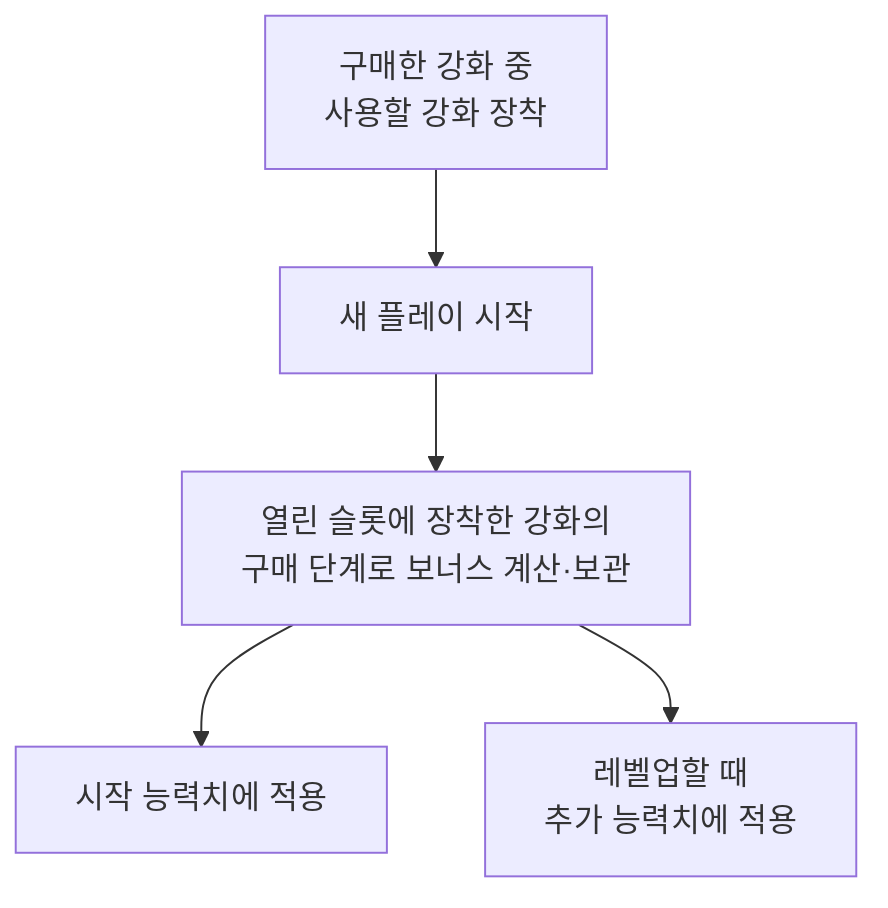
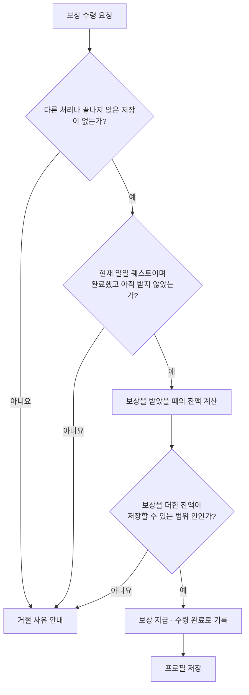
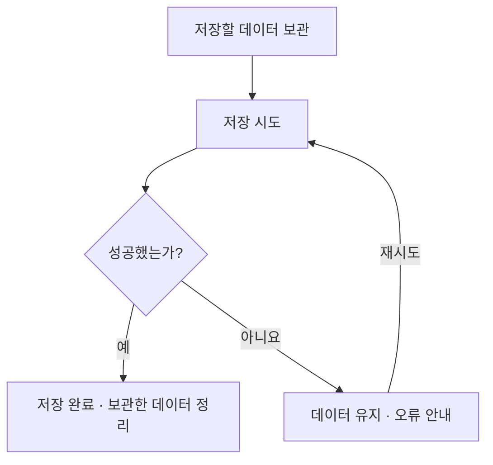

# GroupATeamProject

> Unity 6 · URP 기반 싱글 플레이 쿼터뷰 액션 로그라이트 — 팀 프로젝트 개인 기여 포트폴리오

스킬을 사용해 적과 싸우며, 레벨은 플레이할 때마다 1부터 시작합니다. 구매한 영구 강화는 다음 플레이에도 유지됩니다.

팀장으로 참여해 저장소와 개발 문서를 준비하고 PR 병합과 기능 통합을 맡았습니다. 개발에서는 플레이어 조작과 스킬, 성장·영구 강화, 퀘스트, 로비, 로그인·저장, 카메라·환경 연출, 개발 도구를 구현했습니다.

## 프로젝트 정보

| 항목 | 내용 |
| --- | --- |
| 장르 | 싱글 플레이 쿼터뷰 액션 로그라이트 |
| 레퍼런스 | Shape of Dreams |
| 엔진 | Unity 6000.0.68f1 |
| 렌더 파이프라인 | Universal Render Pipeline |
| 언어 | C# |
| 개발 형태 | 팀 프로젝트 |
| 역할 | 팀장 · 클라이언트 개발 |
| 개발 기간 | 2026년 10월 8일 ~ 11월 20일 |

## 담당 구현 요약

| 구분 | 구현 내용 |
| --- | --- |
| 플레이어 조작 | 마우스 이동·공격, 기본 공격 콤보, 전투 HUD |
| 스킬 | 이동 스킬과 슬롯 스킬 4개, 돌진·범위 스킬, 스킬바, 대시 잔상 |
| 성장과 영구 강화 | 플레이 중 레벨 성장, 영구 강화 구매·장착, 다음 플레이의 능력치 반영 |
| 퀘스트 | 일일 퀘스트의 진행 계산, 완료 판정, 보상 지급 |
| 로그인과 프로필 저장 | Google 로그인, 서버 저장(테스트용 로컬 저장), 저장 실패 시 재시도 |
| 로비와 화면 전환 | 캐릭터 선택과 능력치 비교, 로비와 플레이 사이의 전환과 로딩 화면 |
| 카메라와 환경 연출 | 캐릭터를 가리는 장애물 잘라내기, 물가 발광과 너울, 반딧불 |

## 팀장으로 한 일

- 저장소를 만들고 폴더 구조, 패키지, 초기 에셋을 구성했습니다.
- 프로젝트 구조, 시스템별 책임 범위, 코딩 규칙과 리뷰 절차를 문서로 작성했습니다.
- PR 병합을 맡았고, 각자 만든 기능이 맞닿는 부분을 수정해 연결했습니다. 플레이 시작 순서, 적 처치 경험치 지급, 조작 잠금, HUD 표시, 퀘스트 결과 전달이 여기에 해당합니다.
- 다른 담당자의 코드는 말없이 고치지 않고, 이미 열려 있는 기능을 사용해 제 쪽에서 연결했습니다.
- UI 담당자가 스킬을 직접 확인할 수 있도록, 테스트 씬을 첫 씬으로 넣은 빌드에서는 로그인 없이 바로 시작되게 했습니다.

## 주요 기능

### 플레이어 조작

레퍼런스 게임의 조작을 따라, 마우스로 이동할 위치와 공격할 적을 지정하는 방식으로 만들었습니다. 플레이어 입력·이동·애니메이션을 구현했습니다.

행동 직후 움직일 수 없는 동안 들어온 이동·공격 클릭은 버리지 않고, 마지막 하나를 0.3초 동안 보관했다가 실행합니다.

기본 공격 콤보는 단계마다 모션과 타격 시점을 데이터로 정합니다. 공격 속도가 올라가도 모션과 타격 시점은 그대로 두고 단계 사이의 간격만 줄어들게 했습니다. 현재 기사와 마법사 데이터에는 한 단계씩만 넣었습니다.

공격과 스킬을 쓸 때마다 이펙트를 새로 만들고 지우면 그때마다 부담이 생겨, 사용이 끝난 전투 이펙트는 보관했다가 다음에 다시 꺼내 씁니다.

### 스킬

플레이 도중에 스킬을 얻고, 강화하고, 슬롯을 바꿔 끼우는 게임이라 스킬을 슬롯에 고정하지 않고 데이터로 만들었습니다. 이동 스킬과 QWER 슬롯의 스킬을 사용할 수 있도록 했고, 스킬 실행과 피해 계산을 구현했습니다.

투사체는 발사할 때의 능력치를 기준으로 피해를 계산합니다. 날아가는 도중에 캐릭터가 강화되더라도 이미 발사한 투사체에는 영향을 주지 않습니다.

돌진 공격 스킬은 커서 방향으로 돌진해 도착한 위치에 범위 피해를 주며, 장애물에 막히면 멈춘 자리에서 피해를 줍니다. 일정 간격으로 피해를 주는 범위 스킬은 한 자리에 고정하거나 시전자를 따라다니게 할 수 있고, 발동 직후 잠시 움직이지 못하는 시간도 스킬마다 정할 수 있습니다.

스킬 설명의 피해 계수와 사거리는 실제 데이터에서 가져와 표시하고, 강화할 때는 다음 레벨에서 얼마나 오르는지 함께 보여줍니다. 설명에 숫자를 직접 적어 두지 않아, 수치를 바꿔도 설명을 다시 고칠 필요가 없습니다.

강화한 스킬을 다른 슬롯으로 옮겨도 강화 레벨과 남은 쿨타임은 그대로 이어집니다. 쿨타임을 줄이는 강화를 구매한 경우에는 다음 사용부터 적용됩니다.

### 성장과 영구 강화

레벨이 플레이마다 1부터 시작하기 때문에, 플레이를 거듭해도 남는 성장으로 영구 강화를 두었습니다. 캐릭터를 바꿔도 다시 사지 않도록 구매 단계는 계정 전체가 공유하고, 장착 구성은 캐릭터마다 따로 가집니다. 장착 슬롯은 여섯 개이며 캐릭터 숙련도 레벨에 따라 열립니다.

장착한 영구 강화가 이번 플레이의 능력치에 적용되는 과정은 다음과 같습니다.

한 번에 많은 경험치를 얻어 여러 레벨이 오르는 경우에도 각 레벨의 성장 효과를 순서대로 반영합니다.

### 퀘스트

일일 퀘스트는 영구 강화를 사는 재화를 얻는 경로이자, 플레이마다 목표를 주기 위해 넣었습니다. 재화가 걸려 있어, 보상은 아래 순서로 조건을 모두 확인한 뒤에 지급합니다.

### 프로필 저장

영구 강화와 재화는 플레이를 거듭해 쌓이는 기록이라 계정에 묶어 Firestore 서버에 저장합니다. 서버를 연결하기 전에는 로컬 JSON 파일로 먼저 개발했기 때문에, 게임 기능에서는 저장 위치가 로컬 파일인지 서버인지 구분하지 않고 저장을 요청하게 했습니다. 지금 로컬 파일은 로그인 없이 에디터에서 테스트할 때 씁니다.

저장을 다시 시도할 때 보상 지급이나 성장 처리가 반복되지 않도록, 처음 저장하려던 데이터를 그대로 사용합니다.

### 카메라와 환경 연출

캐릭터가 나무나 바위 뒤로 들어가면 보이지 않아, 캐릭터 주변을 원형으로 잘라내 가려지지 않게 했습니다. 장애물마다 셰이더를 고치는 방법이 있었지만, 대부분 외부에서 가져온 에셋이라 원본은 고치지 않기로 했습니다.

카메라가 화면을 그릴 때 잘라내는 단계를 추가해, 가리는 물체에 레이어만 지정하면 적용되는 방식을 만들었습니다. 현재 맵에서는 지형에 심은 나무에만 적용했고, 나무는 원본 셰이더를 복사한 사본에 같은 잘라내기를 넣은 머티리얼로 처리했습니다.

레퍼런스 게임의 어두운 맵에서 빛나는 분위기를 내기 위해, 맵의 물에는 지형과 닿는 경계가 빛나고 수면에 너울이 이는 연출을 넣었습니다. 너울의 크기는 물마다 조절할 수 있습니다.

같은 분위기를 위해 맵에는 경로를 따라 움직이며 밝아졌다 어두워지는 반딧불을 배치할 수 있게 했습니다. 경로는 씬에서 직접 그려 지정하고, 경로마다 마릿수와 간격을 정합니다. 반딧불은 현재 테스트 맵에만 배치했습니다.

## 사용 기술

| 기술 | 사용 목적 |
| --- | --- |
| Unity 6 / C# | 게임 기능 개발 |
| Universal Render Pipeline | 3D 렌더링 |
| URP Renderer Feature | 캐릭터를 가리는 장애물 잘라내기 |
| Cinemachine | 카메라 추적 대상 연동 |
| Splines | 반딧불 이동 경로 |
| ScriptableObject | 스킬·콤보·캐릭터·퀘스트 설정 |
| NavMesh | 이동, 돌진 경로 검사, 미니맵 추출 |
| Unity UI / TextMeshPro | 게임 화면과 텍스트 표시 |
| Firebase Authentication / Firestore | 로그인과 계정 데이터 저장 |
| Newtonsoft Json / 로컬 JSON | 저장 데이터 변환과 파일 저장 |
| C# event / Task | 변경 알림과 비동기 저장 |
| Unity Editor Extension | 데이터 편집, 스킬 실험, 이펙트 미리보기, 맵 생성 |

## AI 활용 사례

개발 전반에 Codex를 사용했습니다. 게임 기능 코드는 AI가 제시한 코드를 읽고 확인한 뒤 직접 옮겨 적고, 플레이해서 검증했습니다. 프로젝트 후반의 셰이더, UI 배치, 밸런스 수치는 제가 승인한 범위에서 AI가 직접 수정했습니다.

아래 에디터 도구는 AI로 만들었습니다.

| 도구 | 역할 |
| --- | --- |
| 스킬 데이터 관리 · 스킬 실험 | 스킬 데이터를 편집·복제하고, 테스트 씬에서 예상 범위와 실제 적중 결과를 비교합니다. |
| 메타 강화 편집기 · CSV 변환 | 영구 강화 데이터를 표로 고치고 검사한 뒤 JSON으로 내보냅니다. |
| 이펙트 변환 · 미리보기 | 외부 이펙트를 게임용 프리팹으로 바꾸고, 이펙트와 투사체의 재생을 확인합니다. |
| 맵 생성 · 이동 영역 칠하기 | 기준 지형을 측정해 새 지형과 배치물을 만들고, 이동할 수 있는 영역을 나누어 칠합니다. |
| 미니맵 내보내기 | 이동할 수 있는 영역을 위에서 본 이미지로 저장합니다. |

## 저장소 범위

이 저장소에는 팀 프로젝트의 스크립트 전체가 들어 있고, 이 문서는 그중 제가 작성한 부분만 설명합니다. 씬·리소스·패키지 설정은 포함하지 않아 이 저장소만으로 게임을 실행할 수는 없습니다.

외부 모델·애니메이션·VFX를 게임에 적용했습니다.

## Contact

- GitHub: [limrum09](https://github.com/limrum09)
