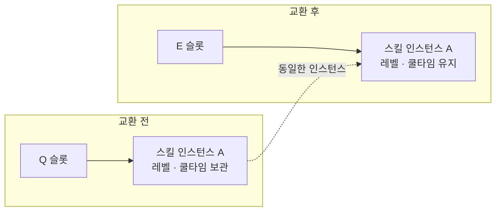
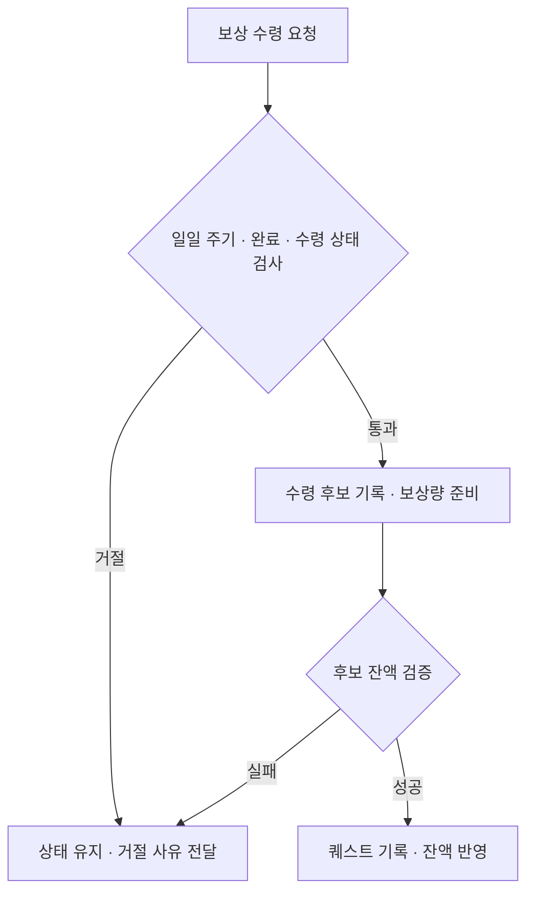
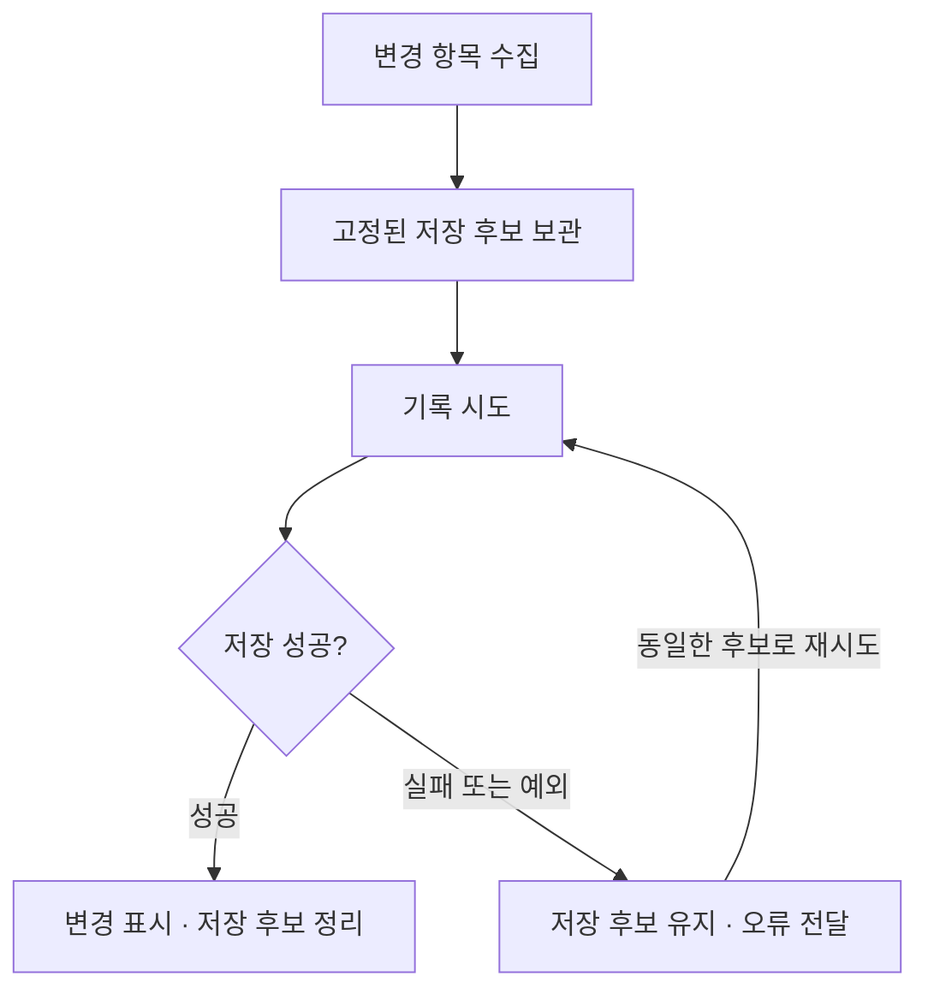

# GroupATeamProject

> Unity 6 · URP 기반 싱글 플레이 쿼터뷰 액션 로그라이트 — 팀 프로젝트 개인 기여 포트폴리오

플레이어가 스킬을 사용해 전투하고, 런 중 성장과 영구 강화를 이어 가는 액션 로그라이트 팀 프로젝트입니다.

팀장으로서 플레이어·스킬·성장·퀘스트·프로필 저장과 주요 UI를 개발하고, PR 병합 및 팀원 기능과의 연결 작업을 담당했습니다. 이 README는 **스킬 상태 보존, 퀘스트 진행·수령 처리, 프로필 저장 재시도**를 중심으로 개인 구현을 설명합니다. 나머지 기여는 부록에 정리했습니다.

## Project Info

| 항목 | 내용 |
| --- | --- |
| 장르 | 싱글 플레이 쿼터뷰 액션 로그라이트 |
| 엔진 | Unity 6000.0.68f1 |
| 렌더 파이프라인 | Universal Render Pipeline |
| 언어 | C# |
| 개발 형태 | 팀 프로젝트 |
| 담당 역할 | 팀장 · 게임플레이 및 UI 프로그래밍 · 기능 통합 |
| 저장소 구성 | 개인 기여 설명과 프로젝트 스크립트 |

## My Role

| 구분 | 담당 범위 |
| --- | --- |
| 본인 주도 구현 | 플레이어 조작, 스킬 상태·실행·피해 계산, 성장·영구 강화, 퀘스트, 주요 로비·플레이어 UI, 프로필 저장·인증, 개발 도구 |
| 공동 작업 | 공용 전투 컨트롤러, 게임 흐름·씬 전환, 로비 UI 통합, 세션 초기화, 상점·퀘스트·스킬 연결 |
| 팀원 주도 구현 | 적 AI·스폰·애니메이션, 맵·노드 진행, 상점 주요 기능, 캐릭터 스토리, 메뉴·설정, 런 점수·결산 |

## Core Implementation Summary

| 핵심 구현 | 다룬 문제 | 주요 클래스 |
| --- | --- | --- |
| Skill — 상태 보존과 발동 기준 | 슬롯 변경·강화·지연 적중 사이에서 상태와 계산 기준 유지 | SkillInstance, SkillLoadout, SkillExecutionContext, SkillDamageResolver |
| Quest — 진행과 수령 구분 | 목표 유형별 계산, 미정산 진행 분리, 수령 자격 검증 | ObjectiveEvaluator, QuestProgress, QuestRecord, QuestManager, QuestActionService |
| Save — 실패 데이터 재시도 | 변경 데이터 고정, 실패 상태 유지, 동일 데이터 재기록 | MetaSaveChanges, MetaProfileSaveCoordinator, IMetaProfileStore |

## Key Features

### 1. Skill — 상태를 보존하는 스킬 실행 시스템

스킬의 설정 데이터, 런타임 상태, 슬롯 관리와 피해 계산을 구현했습니다. 공용 전투 컨트롤러의 후속 수정과 적 공격 연결은 팀원과 함께 작업했습니다.

스킬 슬롯을 옮기더라도 강화 레벨과 남은 쿨타임은 유지되어야 합니다. 이를 위해 스킬 설정은 `SkillDefinition`, 플레이 중 변하는 레벨과 쿨타임은 `SkillInstance`에서 관리하고, 슬롯은 해당 인스턴스의 참조를 보관하도록 했습니다. 슬롯 교환 시에는 같은 인스턴스를 이동시키며, 선택 당시의 스킬과 현재 슬롯의 스킬이 다르면 요청을 거절합니다. 같은 런에서 초기화 요청이 반복될 때도 기존 장착 상태를 유지합니다.

쿨타임을 시작할 때 지속 시간과 종료 시각을 저장합니다. 강화로 쿨타임이 줄어들어도 이미 시작한 대기 시간은 바꾸지 않고, 줄어든 쿨타임은 다음 사용부터 적용합니다.

투사체처럼 발동과 적중 시점이 다른 공격에는 별도의 실행 정보를 사용합니다. `SkillExecutionContext`에 발동 당시의 능력치와 성장값을 보관하고, `SkillDamageResolver`가 이 값을 기준으로 피해를 계산합니다.



<details>
<summary>TrySwapSlots 코드 보기</summary>

```csharp
public bool TrySwapSlots(int first, int second, SkillInstance expectedSource = null)
{
    if (!CanEdit || !IsValidSlot(first) || !IsValidSlot(second))
        return false;

    if (expectedSource != null && _slots[first] != expectedSource)
        return false;

    if (first == second)
        return true;

    SkillInstance temporary = _slots[first];
    _slots[first] = _slots[second];
    _slots[second] = temporary;

    OnChanged?.Invoke();
    return true;
}
```

</details>

**관련 코드:** [SkillLoadout](Assets/_Project/02.Scripts/Skills/SkillLoadout.cs#L139), [SkillInstance](Assets/_Project/02.Scripts/Skills/SkillInstance.cs#L13), [SkillExecutionContext](Assets/_Project/02.Scripts/Skills/SkillExecutionContext.cs#L42), [SkillDamageResolver](Assets/_Project/02.Scripts/Skills/SkillDamageResolver.cs#L12)

### 2. Quest — 진행과 보상 수령을 구분한 퀘스트 시스템

퀘스트의 조건 평가, 진행·수령 기록, 일일 퀘스트 선택과 보상 요청 처리를 구현했습니다. 팀원이 개발한 적·월드·상점 기능에서 전달되는 결과를 받아 퀘스트 진행에 반영하고, 프로필 저장 흐름과 연결했습니다.

퀘스트는 목표에 따라 진행값을 계산하는 방식이 다릅니다. 적 처치 수와 획득 골드는 누적해야 하지만, 보유 골드는 현재 잔액을 사용해야 하고, 클리어한 노드의 최고 Rank는 이전보다 높은 값만 반영해야 합니다. 이러한 차이를 `Add`, `Set`, `Maximum`으로 나누고, `QuestProgress`가 목표 조건을 확인한 뒤 공통 계산기를 사용하도록 구성했습니다.

런 중 쌓이는 진행과 프로필에 반영할 기록도 별도로 관리합니다. 저장 데이터를 수집할 때는 미정산 진행을 제외한 기록을 사용합니다. 정산 없이 런을 폐기하는 경우에는 보류 중인 돌발 보상과 현재 진행을 정리하고, 기존 기록으로 일일 퀘스트를 재구성합니다. 프로필에 기록을 반영한 상태와 파일·서버에 저장을 완료한 상태는 별도로 구분합니다.

보상 수령에는 완료 여부뿐 아니라 수령 여부와 일일 주기를 함께 확인합니다. `TryPrepareClaim()`은 현재 주기의 완료된 미수령 퀘스트에 대해서만 후보 기록과 보상량을 준비합니다. 이후 `QuestActionService`가 지갑의 후보 잔액까지 검증한 뒤 퀘스트 기록과 잔액을 반영합니다. 반영 도중 예외가 발생하면 추가 퀘스트 작업을 차단합니다.



<details>
<summary>TryPrepareClaim 코드 보기</summary>

```csharp
public bool TryPrepareClaim(
    string questId,
    string periodKey,
    out IReadOnlyList<QuestRecord> records,
    out long reward,
    out string message)
{
    RequireInitialized();

    records = null;
    reward = 0;
    message = null;

    if (periodKey != _dailyPeriod)
    {
        message = "일일 퀘스트 주기가 변경되었습니다.";
        return false;
    }

    List<QuestRecord> candidate = BuildProgressRecords();

    int index = candidate.FindIndex(item =>
        item.Kind == QuestKind.Daily &&
        item.QuestId == questId &&
        item.PeriodKey == periodKey);

    if (index < 0)
    {
        message = "수령할 퀘스트 기록이 없습니다.";
        return false;
    }

    QuestRecord record = candidate[index];

    if (!record.IsCompleted || record.IsClaimed)
    {
        message = "완료된 미수령 퀘스트만 수령할 수 있습니다.";
        return false;
    }

    QuestDefinition definition =
        _definitionCatalog.GetDefinition(questId);

    candidate[index] = record.CreateClaimedRecord();

    records = candidate;
    reward = definition.MetaGoldReward;
    return true;
}
```

</details>

**관련 코드:** [QuestManager](Assets/_Project/02.Scripts/Quest/QuestManager.cs#L510), [ObjectiveEvaluator](Assets/_Project/02.Scripts/Quest/ObjectiveEvaluator.cs#L28), [QuestProgress](Assets/_Project/02.Scripts/Quest/QuestProgress.cs#L80), [QuestRecord](Assets/_Project/02.Scripts/Quest/QuestRecord.cs#L65), [QuestActionService](Assets/_Project/02.Scripts/Quest/QuestActionService.cs#L145)

### 3. Save — 실패한 데이터를 그대로 재시도하는 프로필 저장

영구 데이터의 저장 형식, 저장 요청 조정, 실패 재시도와 로컬·Firestore 저장소 구현을 맡았습니다. 런 점수와 결산 보상 계산은 팀원이 담당했습니다.

저장에 실패했을 때는 게임 내 보상이나 성장 결과가 이미 반영되어 있을 수 있습니다. 따라서 재시도 과정에서 게임 규칙을 다시 실행하지 않도록, 변경된 항목을 `MetaSaveChanges`에 저장용 복사본으로 구성하고 대기 데이터로 보관했습니다.

`MetaProfileSaveCoordinator`는 저장이 성공한 경우에만 해당 변경 표시와 대기 데이터를 정리합니다. 실패하거나 예외가 발생하면 데이터를 보관하고 오류를 전달합니다. `RetryAsync()`는 보관한 데이터로 저장을 다시 시도합니다. 저장 중이거나 실패한 작업이 남아 있는 동안에는 관련 기능의 추가 변경을 제한합니다.

로컬 저장에서는 임시 파일에 새 내용을 기록한 뒤 본파일을 교체하고 백업을 남기도록 했습니다. 파일 기록이 성공한 후에만 메모리에 보관한 기준 저장본을 갱신합니다. 로컬 저장소와 Firestore 저장소는 모두 `IMetaProfileStore`를 구현합니다. 호출하는 쪽에서는 저장 위치와 관계없이 같은 메서드로 저장을 요청합니다.



<details>
<summary>WritePendingAsync 코드 보기</summary>

```csharp
async Task<bool> WritePendingAsync()
{
    _writing = true;
    ErrorMessage = null;
    PublishChanged();

    bool saved = false;

    try
    {
        saved = await _writeAsync(_pending);

        if (saved)
        {
            _dirty &= ~_pending.Parts;
            _pending = null;
        }
        else
        {
            ErrorMessage = "변경 내용을 저장하지 못했습니다.";
        }
    }
    catch (Exception exception)
    {
        ErrorMessage = exception.Message;

        if (!_disposed)
            Debug.LogException(exception);
    }
    finally
    {
        _writing = false;
        PublishChanged();
    }

    return saved && !_disposed;
}
```

</details>

**관련 코드:** [MetaProfileSaveCoordinator](Assets/_Project/02.Scripts/GameFlow/Save/MetaProfileSaveCoordinator.cs#L108), [MetaSaveChanges](Assets/_Project/02.Scripts/Persistence/MetaSaveChanges.cs#L60), [IMetaProfileStore](Assets/_Project/02.Scripts/Persistence/IMetaProfileStore.cs#L6), [LocalMetaProfileStore](Assets/_Project/02.Scripts/Persistence/LocalMetaProfileStore.cs#L287), [FirestoreMetaProfileStore](Assets/_Project/02.Scripts/Persistence/FirestoreMetaProfileStore.cs#L94)

## Appendix — 기타 개인 기여

| 영역 | 본인이 맡은 작업 | 대표 코드 |
| --- | --- | --- |
| 플레이어 조작 | 입력·이동·애니메이션 구현. 월드 배치와 세션 연결은 공동 작업 | [PlayerMovement](Assets/_Project/02.Scripts/Player/PlayerMovement.cs) |
| 성장·영구 강화 | 런 레벨 성장, 캐릭터 성장 계산, 영구 강화와 메타 재화 처리 | [MetaProgression](Assets/_Project/02.Scripts/Progression/MetaProgression.cs) |
| 로비·플레이어 UI | 캐릭터 선택, 영구 강화, 능력치·재화 표시, 플레이어 체력·프로필 HUD | [LobbyCharacterSelectPresenter](Assets/_Project/02.Scripts/UI/Lobby/LobbyCharacterSelect/LobbyCharacterSelectPresenter.cs) |
| 인증 | Firebase 초기화·인증, Google 로그인과 로그인 UI 연동 | [FirebaseAuthService](Assets/_Project/02.Scripts/Firebase/Authentication/FirebaseAuthService.cs) |
| 전투 연출 도구 | 전투 이펙트 재생·풀링, 스펠 변환·미리보기·검증, 투사체 미리보기 | [FantasySpellBaker](Assets/_Project/02.Scripts/Presentation/FantasySpells/Editor/FantasySpellBaker.cs) |
| 데이터·에디터 도구 | CSV 변환, 퀘스트·스킬 데이터 편집·검증, 맵 테스트 씬 도구 | [CsvToJsonConverter](Assets/_Project/02.Scripts/Common/Data/CsvToJsonConverter.cs) |
| 게임 흐름·팀 통합 | 게임 흐름·씬 전환 기반 구현, PR 병합, 세션·UI·퀘스트·상점 연결 및 공동 수정 | [GameFlowController](Assets/_Project/02.Scripts/GameFlow/GameFlowController.cs) |

외부 리소스를 게임에 적용하기 위한 재생 코드와 변환·검증 도구를 작성했습니다. 모델·애니메이션·VFX 등 외부 에셋의 원작 제작과 구분합니다.

## Tech Stack

| 기술 | 사용 목적 |
| --- | --- |
| Unity 6 / C# | 플레이어 조작, 전투·스킬, 성장, 퀘스트와 UI 구현 |
| Universal Render Pipeline | 게임의 3D 렌더링 |
| ScriptableObject | 스킬·캐릭터·퀘스트의 설정 데이터 |
| Unity UI / TextMeshPro | 로비, 플레이어 HUD, 스킬바와 퀘스트 화면 |
| Firebase Authentication / Firestore | 사용자 인증과 계정 프로필 저장 |
| Newtonsoft Json / 로컬 JSON | 프로필 데이터 변환과 로컬 파일 저장 |
| C# event / Task | 상태 변경 통지와 비동기 저장 흐름 |
| Unity Editor Extension | 데이터 편집·검증과 스킬·투사체 미리보기 도구 |

## Repository Scope

이 저장소에는 프로젝트 스크립트와 개인 기여를 정리한 README가 들어 있습니다. 게임 실행에 필요한 씬·리소스·패키지 설정은 포함되어 있지 않습니다.

## Verification Scope

아래는 본문 사례를 정리할 때 확인한 범위입니다.

| 구분 | 확인 범위 |
| --- | --- |
| 소스 확인 | 관련 소스의 처리 흐름 확인 및 대표 코드 발췌문과 원본 대조 |
| 개인 기여 확인 | Git 작성·수정 이력을 바탕으로 본인 구현과 공동 작업 범위 구분 |
| 실행 검증 | 미실시 — 빌드·플레이·장애 재현 테스트 결과는 추후 추가 |

본문은 소스 코드에서 확인한 구현을 설명합니다. 실제 실행 결과와 성능 측정값은 검증 후 추가합니다.

## Contact

- GitHub: [limrum09](https://github.com/limrum09)
