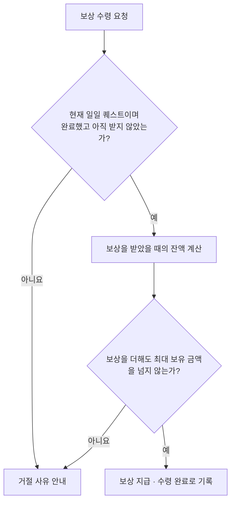
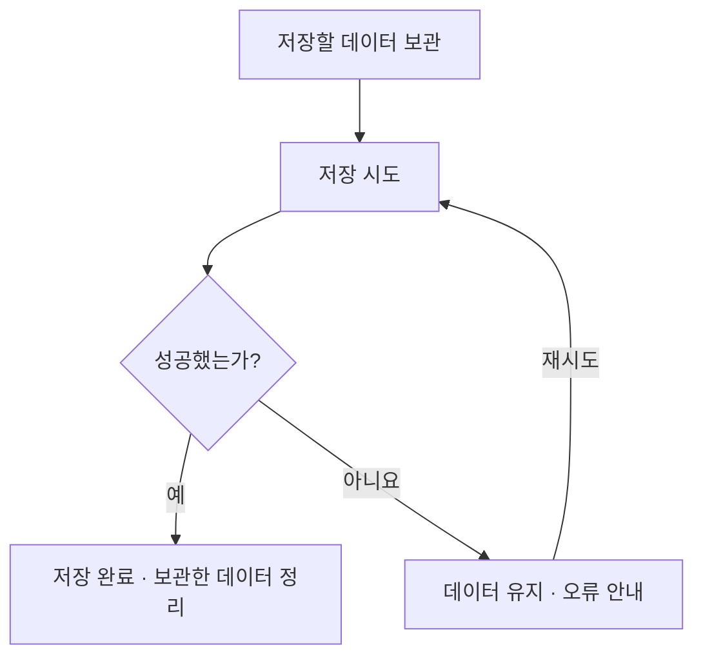

# GroupATeamProject

> Unity 6 · URP 기반 싱글 플레이 쿼터뷰 액션 로그라이트 — 팀 프로젝트 개인 기여 포트폴리오

스킬을 사용해 적과 싸우며, 레벨은 플레이할 때마다 1부터 시작합니다. 구매한 영구 강화는 다음 플레이에도 유지됩니다.

팀장으로 참여해 플레이어와 주요 게임 기능을 개발하고, 팀원들이 만든 기능을 연결하는 작업을 맡았습니다.

## 프로젝트 정보

| 항목 | 내용 |
| --- | --- |
| 장르 | 싱글 플레이 쿼터뷰 액션 로그라이트 |
| 엔진 | Unity 6000.0.68f1 |
| 렌더 파이프라인 | Universal Render Pipeline |
| 언어 | C# |
| 개발 형태 | 팀 프로젝트 |

## 담당 작업

| 구분 | 담당 작업 |
| --- | --- |
| 주로 맡은 작업 | 플레이어 조작, 스킬, 성장·영구 강화, 퀘스트, 주요 UI, 프로필 저장·인증, 개발 도구 |
| 함께 작업한 부분 | 공용 전투 처리, 게임 흐름과 씬 전환, 로비 UI 통합, 플레이 시작 시 초기화, 상점·퀘스트·스킬 연결 |
| 팀원이 주로 맡은 작업 | 적 AI와 스폰·애니메이션, 맵 진행, 상점 주요 기능, 캐릭터 스토리, 메뉴·설정, 점수·결산 |

## 주요 기능

### 플레이어 조작과 스킬

플레이어가 마우스로 지정한 위치로 이동하거나 적을 공격하고, 이동 스킬과 QWER 슬롯의 스킬을 사용할 수 있도록 했습니다. 플레이어 입력·이동·애니메이션과 스킬 실행·피해 계산을 맡았으며, 공용 전투 처리의 후속 수정과 적 공격 연결은 팀원과 함께 작업했습니다.

스킬바에는 장착한 스킬의 아이콘과 남은 쿨타임을 표시하고, 마우스를 올리면 이름·레벨·설명을 보여줍니다. 아이콘을 드래그해 슬롯을 바꾸거나, 강화 비용을 확인하고 선택한 스킬을 강화할 수 있습니다. 전투 중 체력과 플레이어 프로필을 표시하는 HUD도 구현했습니다.

강화한 스킬을 다른 슬롯으로 옮겨도 강화 레벨과 남은 쿨타임은 그대로 이어집니다. 쿨타임을 줄이는 강화를 구매한 경우에는 다음 사용부터 적용됩니다.

투사체는 발사할 때의 능력치를 기준으로 피해를 계산합니다. 날아가는 도중에 캐릭터가 강화되더라도 이미 발사한 투사체에는 영향을 주지 않습니다.

전투 이펙트의 재생과 재사용 기능도 만들었습니다. 사용이 끝난 이펙트는 보관했다가 다음에 다시 꺼내 씁니다.

### 성장과 영구 강화

플레이 중 얻은 경험치로 레벨이 오르고, 캐릭터 설정에 따라 능력치가 바뀌는 성장 기능을 맡았습니다. 한 번에 많은 경험치를 얻어 여러 레벨이 오르는 경우에도 각 레벨의 성장 효과를 순서대로 반영합니다. 새 플레이를 시작하면 레벨과 경험치는 다시 초기화됩니다.

로비에서는 영구 재화로 강화를 구매하고 캐릭터의 슬롯에 장착할 수 있습니다. 강화 화면에는 현재 구매 단계, 효과와 다음 단계의 비용을 표시합니다. 보유 재화와 최대 단계에 맞춰 구매 버튼을 활성화하고, 구매가 끝나면 강화 단계와 남은 재화 표시를 갱신하도록 구현했습니다.

구매한 강화는 장착·해제하거나 드래그로 슬롯을 교환할 수 있습니다. 구매하지 않은 강화는 장착할 수 없고, 같은 강화를 여러 슬롯에 중복 장착할 수도 없습니다.

플레이를 시작할 때 장착한 강화의 구매 단계에 따라 보너스를 계산해 둡니다. 해당 플레이에서는 이 값을 시작 능력치와 레벨업 시 추가되는 능력치에 사용합니다.

### 퀘스트

일일 퀘스트 목록 구성, 목표별 진행 계산, 완료 판정과 보상 수령을 맡았습니다. 팀원이 개발한 적·맵·상점 기능에서 전달되는 처치·클리어·골드 변화 등의 결과를 받아 퀘스트 진행에 반영했습니다.

로비의 일일 퀘스트 화면에는 목표 설명, 현재 진행도와 목표값, 보상 금액을 표시합니다. 진행 상황에 따라 버튼을 ‘진행 중’, ‘보상 수령’, ‘수령 완료’로 바꾸고, 완료한 미수령 퀘스트만 보상을 받을 수 있게 했습니다. 저장 실패 안내와 재시도 버튼도 이 화면에 구현했습니다.

플레이 중 돌발 퀘스트를 생성할 때는 이미 진행 중인 퀘스트를 제외한 목록에서 하나를 무작위로 선택합니다. 완료한 퀘스트의 보상은 로비 복귀 때 지급할 금액으로 모아 둡니다.

적 처치 수와 획득 골드는 계속 더하고, 보유 골드는 현재 잔액을 사용합니다.

월드 지도에서 이동하는 각 지점은 노드라고 부릅니다. 시작점에서 얼마나 먼 지점까지 클리어했는지 기록하는 목표는, 이전보다 더 먼 노드를 클리어했을 때만 갱신합니다.

일일 퀘스트 보상은 아래 순서로 처리합니다.

퀘스트 기록이나 보상 잔액을 반영하다 오류가 나면, 이후 보상 수령과 일일 퀘스트 갱신, 플레이 결과 반영을 막습니다. 영구 강화 구매·장착 변경과 새 플레이 시작도 제한합니다.

### 로비·로그인·프로필 저장

캐릭터 선택 화면에서 캐릭터 소개와 시작 스킬을 확인하고, 공격력·체력 등 기본 능력치를 비교할 수 있도록 했습니다. 선택한 캐릭터의 숙련도 레벨과 경험치도 표시합니다. 캐릭터 선택, 능력치·재화 표시와 프로필 UI를 맡고, 로비의 화면 전환과 다른 기능의 연결은 팀원과 함께 작업했습니다.

Google 로그인과 Firebase 인증을 연결하고, 인증한 계정의 프로필을 불러온 뒤 로비로 진입하도록 했습니다. 로그인 화면에는 인증과 데이터 준비 상태를 표시하며, 취소되거나 실패한 경우에는 안내 문구를 보여줍니다.

프로필에는 영구 재화, 강화 구매 내역, 장착 구성, 숙련도와 일일 퀘스트 기록을 저장합니다. 다음 접속 때 저장된 내용을 복원해 로비 화면에서 이어서 사용할 수 있도록 했습니다.

로컬 JSON 파일과 Firestore 서버 저장을 지원합니다. 게임 기능에서는 저장 위치가 로컬 파일인지 서버인지 구분하지 않고 저장을 요청합니다. 로컬 저장은 임시 파일에 먼저 기록한 뒤 기존 파일을 교체하고 백업을 남깁니다.

저장을 다시 시도할 때 보상 지급이나 성장 처리가 반복되지 않도록, 처음 저장하려던 데이터를 그대로 사용합니다.

저장을 마칠 때까지 영구 강화 구매와 장착 변경, 일일 퀘스트 보상 수령, 새 플레이 시작은 할 수 없습니다.

### 개발 도구

에디터에서 선택한 CSV를 JSON 파일로 변환하는 메뉴와 스킬·퀘스트 데이터 편집 도구를 만들었습니다. 퀘스트는 목표 유형에 필요한 설정을 보여주고, 스킬은 유형별 설정과 식별자를 검사할 수 있도록 했습니다.

외부 마법 이펙트를 프로젝트에서 재생할 프리팹으로 변환하는 도구도 작성했습니다. 변환 결과에 필요한 구성 요소가 연결되어 있는지, 재생 시간값이 올바른지 검사하고 대표 이펙트의 재생 결과를 확인할 수 있습니다.

스킬 이펙트와 투사체를 확인하는 미리보기 도구에서는 효과의 재생 모습을 살펴보거나 투사체의 속도와 최대 재생 시간을 바꿔 시험할 수 있습니다. 투사체는 단발·반복 발사와 경로 표시를 지원합니다.

로비를 초기화하고 다시 불러오는 테스트 기능을 구현했습니다.

외부 모델·애니메이션·VFX를 게임에 적용했으며, 원본 에셋 제작은 담당하지 않았습니다.

## 팀 기능 통합

팀장으로 PR 병합과 기능 통합을 담당했습니다. 적 처치 결과를 경험치와 퀘스트에 전달하고, 상점의 구매·강화 결과를 재화와 스킬바에 표시하는 부분은 팀원과 함께 작업했습니다.

씬 전환과 새 플레이 준비에서는 여러 기능의 초기화 순서를 함께 맞췄습니다. 골드를 초기화하고, 적의 공격 대상을 플레이어로 지정한 뒤 상점·맵·UI를 연결했습니다. 시작 맵에 플레이어를 배치한 뒤 경험치·골드 보상을 받을 수 있도록 준비하고, HUD를 표시한 다음 플레이를 시작하도록 했습니다.

맵을 이동할 때는 플레이어 조작을 잠시 막고, 목적지에 배치한 뒤 다시 조작할 수 있게 하는 부분도 공동으로 구현했습니다.

## 사용 기술

| 기술 | 사용 목적 |
| --- | --- |
| Unity 6 / C# | 게임 기능 개발 |
| Universal Render Pipeline | 3D 렌더링 |
| ScriptableObject | 스킬·캐릭터·퀘스트 설정 |
| Unity UI / TextMeshPro | 게임 화면과 텍스트 표시 |
| Firebase Authentication / Firestore | 로그인과 계정 데이터 저장 |
| Newtonsoft Json / 로컬 JSON | 저장 데이터 변환과 파일 저장 |
| C# event / Task | 변경 알림과 비동기 저장 |
| Unity Editor Extension | 데이터 편집과 스킬·투사체 미리보기 |

## 저장소와 확인 범위

이 저장소에는 프로젝트 스크립트와 README가 들어 있습니다. 씬·리소스·패키지 설정은 포함하지 않아 이 저장소만으로 게임을 실행할 수는 없습니다.

기능 설명은 소스 코드를 바탕으로 정리했습니다. 이번 확인에서는 실행 테스트와 성능 측정을 진행하지 않았습니다.

## Contact

- GitHub: [limrum09](https://github.com/limrum09)
