# GroupATeamProject

> Unity 6, URP로 만든 싱글 플레이 쿼터뷰 액션 로그라이트 팀 프로젝트입니다. 제가 맡은 부분을 정리했습니다.

스킬을 사용해 적과 싸우며, 레벨은 플레이할 때마다 1부터 시작합니다. 구매한 영구 강화는 다음 플레이에도 유지됩니다.

팀장으로 참여해 저장소와 개발 문서를 준비하고 PR 병합과 기능 통합을 맡았습니다. 개발에서는 플레이어 조작과 스킬을 중심으로 아래 표의 기능과 개발 도구를 구현했습니다.

  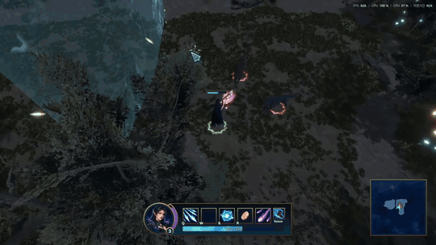

## 프로젝트 정보

| 항목 | 내용 |
| --- | --- |
| 장르 | 싱글 플레이 쿼터뷰 액션 로그라이트 |
| 레퍼런스 | Shape of Dreams |
| 엔진 | Unity 6000.0.68f1 |
| 렌더 파이프라인 | Universal Render Pipeline |
| 언어 | C# |
| 개발 형태 | 팀 프로젝트 |
| 역할 | 팀장 · 클라이언트 개발 |
| 개발 기간 | 2026년 10월 8일 ~ 11월 20일 |

## 담당 기능

| 구분 | 구현 내용 |
| --- | --- |
| 플레이어 조작 | 마우스 이동·공격, 기본 공격 콤보, 전투 HUD |
| 스킬 | 이동 스킬과 슬롯 스킬 4개, 돌진·범위 스킬, 스킬바, 대시 잔상 |
| 성장과 영구 강화 | 플레이 중 레벨업, 영구 강화 구매·장착, 다음 플레이의 능력치 반영 |
| 퀘스트 | 일일 퀘스트 진행도 계산, 완료 판정, 보상 지급 |
| 로그인과 프로필 저장 | Google 로그인, 서버 저장(테스트용 로컬 저장), 저장 실패 시 재시도 |
| 로비와 화면 전환 | 캐릭터 선택과 능력치 비교, 로비와 플레이 사이의 전환과 로딩 화면 |
| 카메라와 환경 연출 | 캐릭터를 가리는 장애물 잘라내기, 물가 발광과 너울 |

## 팀장으로 한 일

- 저장소를 만들고 폴더 구조, 패키지, 초기 에셋을 구성했습니다.
- 프로젝트 구조와 코딩 규칙, 리뷰 절차, 누가 어떤 시스템을 맡는지를 문서로 작성했습니다.
- PR 병합을 맡아 플레이 시작 순서를 조정하고, 적을 처치하면 경험치가 지급되도록 연결했습니다. 조작 잠금, HUD 표시, 퀘스트 결과 전달도 이 과정에서 통합했습니다.
- 다른 담당자가 만들어 둔 기능은 제 코드에서 호출해 연결했습니다.
- UI 담당자가 스킬을 직접 확인할 수 있도록 테스트 씬을 첫 씬으로 넣은 빌드에서는 로그인 없이 바로 시작되게 했습니다.

## 주요 기능

### 플레이어 조작

조작은 레퍼런스 게임을 따랐습니다. 마우스로 이동할 위치와 공격할 적을 지정합니다. 플레이어 입력, 이동, 애니메이션을 구현했습니다.

  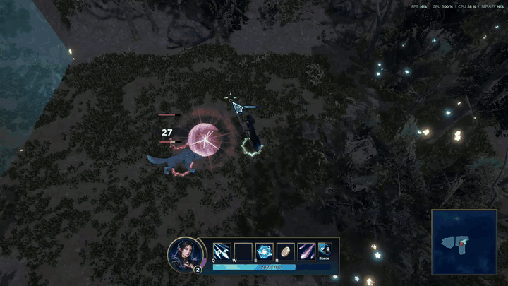

행동 직후 움직일 수 없는 동안 이동이나 공격 클릭이 들어오면 입력 버퍼에 마지막 하나만 0.3초 동안 보관했다가 실행합니다.

기본 공격 콤보는 단계마다 모션과 타격 시점을 데이터로 정합니다. 공격 속도가 올라가도 모션과 타격 시점은 그대로 두고 단계 사이의 간격만 줄어들게 했습니다. 현재 기사와 마법사 데이터에는 한 단계씩만 넣었습니다.

전투 이펙트는 오브젝트 풀에서 꺼내 쓰고 재생이 끝나면 되돌려 놓습니다. 공격과 스킬을 쓸 때마다 새로 만들고 지우는 부담을 줄이려는 것입니다.

### 스킬

스킬은 ScriptableObject 데이터로 만들어 슬롯에 끼워 씁니다. 플레이 도중에 스킬을 얻고, 강화하고, 슬롯을 바꿔 끼우는 게임이기 때문입니다. 이동 스킬과 QWER 슬롯 스킬의 실행과 피해 계산을 구현했습니다.

투사체는 발사할 때의 능력치를 기준으로 피해를 계산합니다. 공격하는 도중에 레벨이 오르거나 스킬이 강화돼도 이미 날아가는 투사체의 피해량이 갑자기 늘지 않게 하려고 따로 관리했습니다.

돌진 공격 스킬은 커서 방향으로 돌진해 도착한 위치에 범위 피해를 줍니다. 장애물에 막히면 멈춘 자리에서 피해를 줍니다. 일정 간격으로 피해를 주는 범위 스킬은 한 자리에 고정하거나 시전자를 따라다니게 할 수 있고, 발동 직후 잠시 움직이지 못하는 시간도 스킬마다 정할 수 있습니다.

<table>
  <tr>
    <td align="center">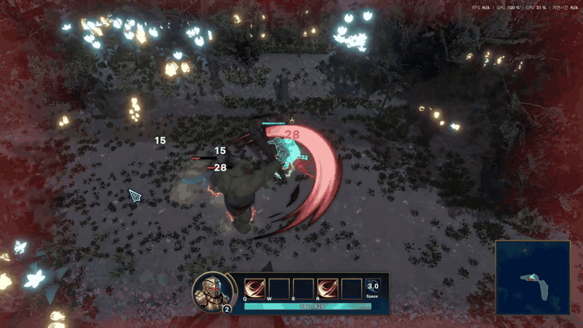</td>
    <td align="center">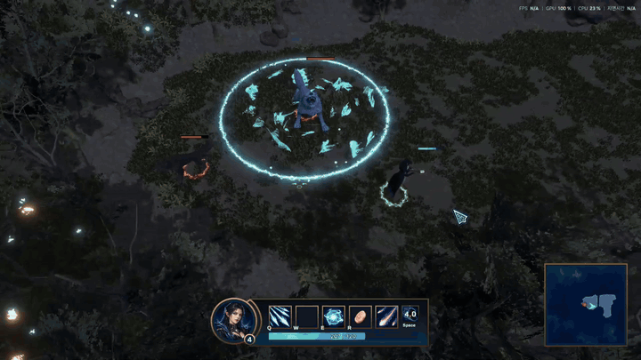</td>
  </tr>
  <tr>
    <td align="center">돌진 공격 스킬 (기사)</td>
    <td align="center">범위 스킬 (마법사)</td>
  </tr>
</table>

이동 스킬은 돌진과 점멸 두 가지 방식으로 만들 수 있습니다. 점멸은 정해진 거리만큼 순간이동합니다. 이동하기 전에 경로를 짧은 구간으로 나눠 바닥과 벽을 검사하고, 중간에 막히면 갈 수 있는 마지막 지점까지만 이동합니다.

스킬 설명의 피해 계수와 사거리는 스킬 데이터에서 가져와 표시합니다. 그래서 수치를 바꾸면 설명도 같이 바뀝니다. 강화할 때는 다음 레벨에서 얼마나 오르는지도 보여줍니다.

  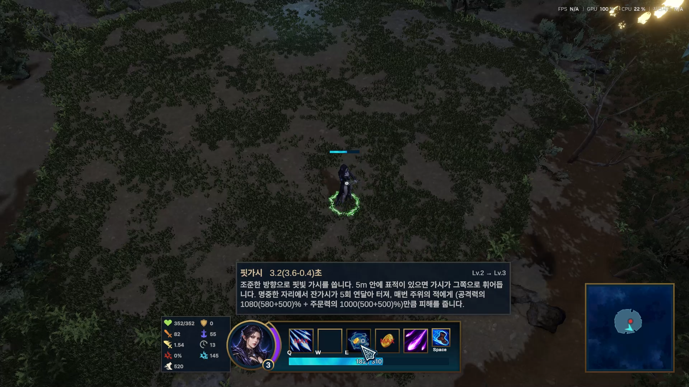

강화한 스킬을 다른 슬롯으로 옮겨도 강화 레벨과 남은 쿨타임은 그대로 이어집니다. 쿨타임을 줄이는 강화를 구매한 경우에는 다음 사용부터 적용됩니다.

### 성장과 영구 강화

플레이를 시작할 때마다 레벨은 1로 돌아가지만, 구매한 영구 강화는 다음 플레이에도 쓸 수 있습니다. 강화 구매 단계는 계정 전체에서 공유하고, 장착할 강화는 캐릭터마다 따로 고릅니다. 장착 슬롯은 총 여섯 개이며 캐릭터 숙련도 레벨에 따라 열립니다.

  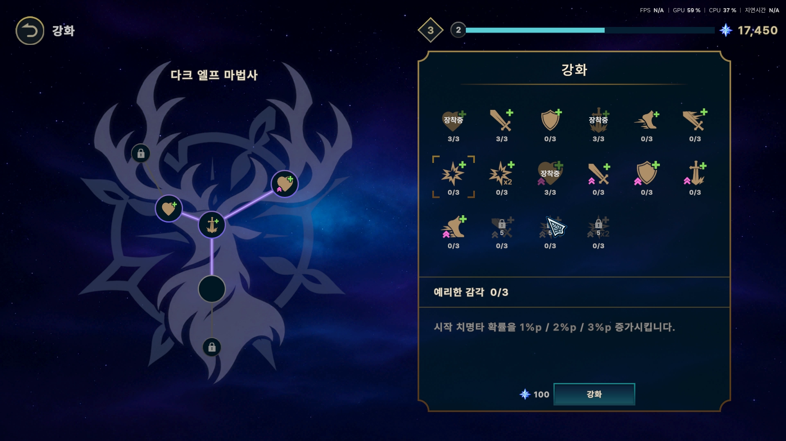

장착한 영구 강화는 아래 순서로 이번 플레이의 능력치에 반영됩니다.

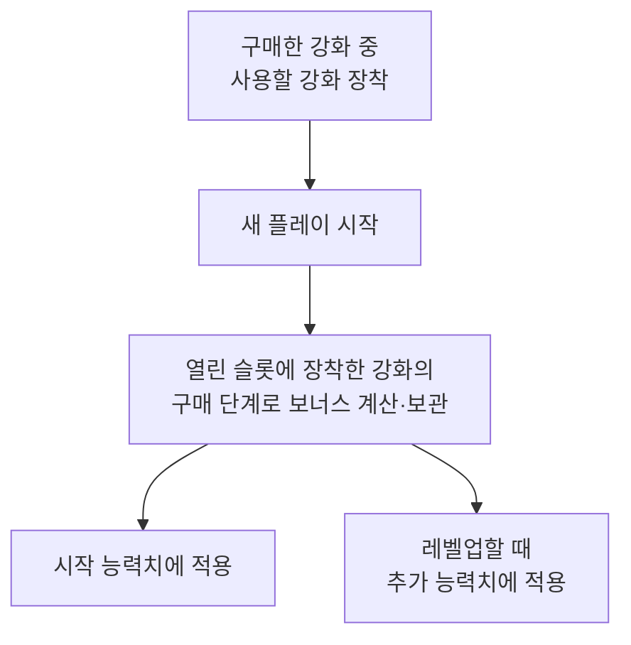

한 번에 많은 경험치를 얻어 여러 레벨이 오르는 경우에도 각 레벨의 성장 효과를 순서대로 반영합니다.

### 퀘스트

플레이마다 목표를 주려고 일일 퀘스트를 넣었습니다. 퀘스트를 완료하면 영구 강화 구매에 쓰는 재화를 받을 수 있습니다. 보상 수령을 요청하면 아래 조건을 순서대로 확인합니다.

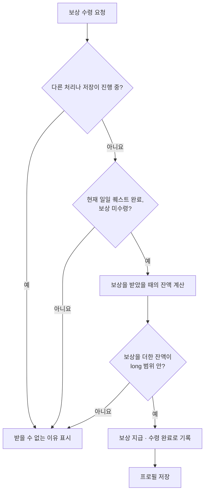

  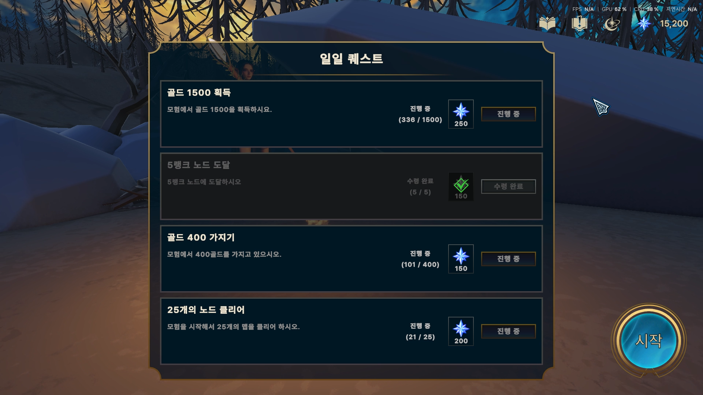

### 프로필 저장

영구 강화와 재화는 플레이를 거듭해 쌓이는 기록이라 계정에 묶어 Firestore 서버에 저장합니다. 서버를 연결하기 전에는 로컬 JSON 파일로 먼저 개발했습니다. 그래서 저장 기능을 인터페이스 하나로 두고 로컬 파일과 Firestore를 각각 구현했습니다. 게임 기능은 어디에 저장되는지 모르고 저장만 요청합니다. 로컬 파일 쪽은 지금도 로그인 없이 에디터에서 테스트할 때 씁니다.

저장에 실패하면 저장하려던 데이터를 그대로 보관하고 오류를 알립니다. 재시도할 때는 그 데이터를 다시 보내기만 해서 보상 지급이나 성장 처리가 두 번 일어나지 않게 했습니다. 저장에 성공하면 보관한 데이터를 정리합니다. 게임을 종료할 때는 저장을 한 번 시도하고, 실패하면 저장하지 못한 변경을 버리고 종료합니다. 다만 저장 실패 상황은 충분히 테스트하지 못했습니다.

### 카메라와 환경 연출

캐릭터가 나무 뒤로 들어가면 보이지 않아 캐릭터 주변을 원형으로 잘라내 가려지지 않게 했습니다. 장애물마다 셰이더를 고치는 방법이 있었지만, 대부분 외부에서 가져온 에셋이라 원본은 고치지 않기로 했습니다.

대신 URP Renderer Feature로 화면을 그리는 과정에 잘라내는 단계를 추가했습니다. 레이어를 지정한 물체를 잘라내는 방식입니다. 다만 현재 맵에서 실제로 잘리는 것은 지형에 심은 나무뿐이고, 나무는 같은 잘라내기 효과를 넣은 셰이더 사본을 머티리얼에 사용했습니다.

  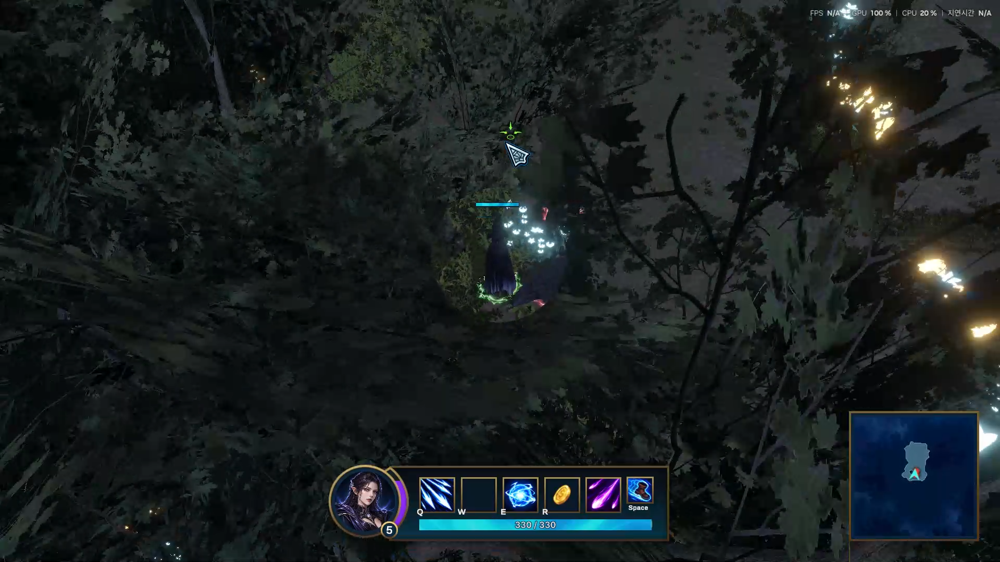

맵의 물은 지형과 닿는 경계가 빛나고 수면에 너울이 입니다. 레퍼런스 게임처럼 어두운 맵에서 빛나는 분위기를 내려고 넣었습니다. 셰이더는 AI로 만들었습니다. 저는 레퍼런스와 비슷한 느낌이 날 때까지 모습과 움직임을 계속 바꾸도록 요구했습니다. 너울의 크기는 물마다 조절할 수 있습니다.

## AI 활용 사례

게임 기능을 개발할 때는 Codex가 제안한 코드를 검토해 직접 입력한 뒤, 게임에서 동작을 확인했습니다. 프로젝트 후반에는 제가 승인한 범위에서 Codex가 셰이더, UI 배치, 밸런스 수치를 직접 수정했습니다.

아래 에디터 도구와 리소스는 AI로 만들었습니다.

| 항목 | 내용 |
| --- | --- |
| 스킬 데이터 관리 · 스킬 실험 | 스킬 데이터를 편집하거나 복제하고 테스트 씬에서 예상 범위와 실제 적중 결과를 비교합니다. |
| 메타 강화 편집기 · CSV 변환 | 영구 강화 데이터를 표로 고치고 검사한 뒤 JSON으로 내보냅니다. |
| 이펙트 변환 · 미리보기 | 외부 이펙트를 게임용 프리팹으로 바꾸고 이펙트와 투사체의 재생을 확인합니다. |
| 맵 생성 · 이동 영역 칠하기 | 기준 지형을 측정해 새 지형과 배치물을 만들고 이동할 수 있는 영역을 나누어 칠합니다. |
| 미니맵 내보내기 | 이동할 수 있는 영역을 위에서 본 이미지로 저장합니다. |
| 발광 꽃 · 물 셰이더 | 맵에 배치할 발광 꽃을 모델링하고 물 가장자리의 빛과 수면 너울을 셰이더로 구현했습니다. |
| 캐릭터 모션 | 애니메이션 클립을 제작해 게임에 적용했습니다. |

  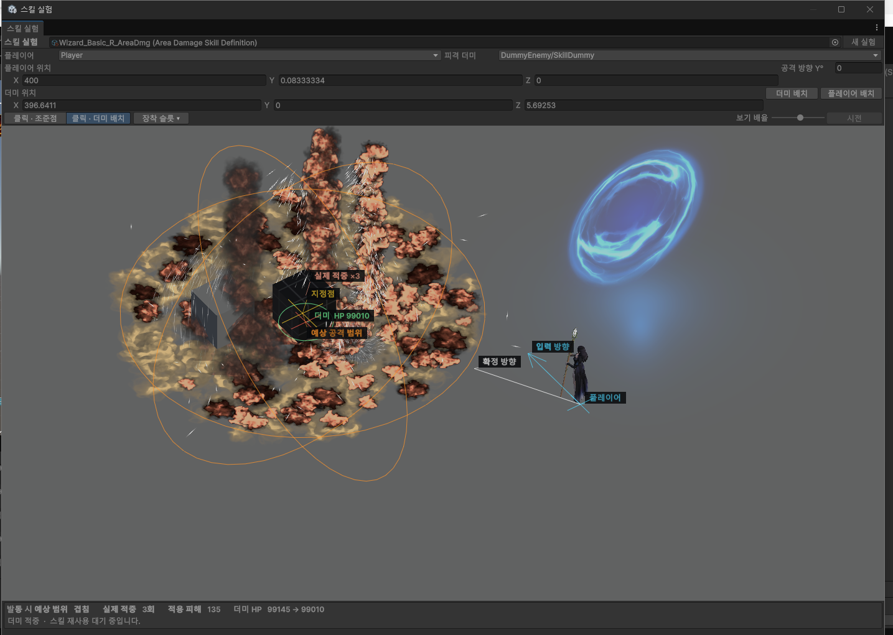 
  스킬 실험

  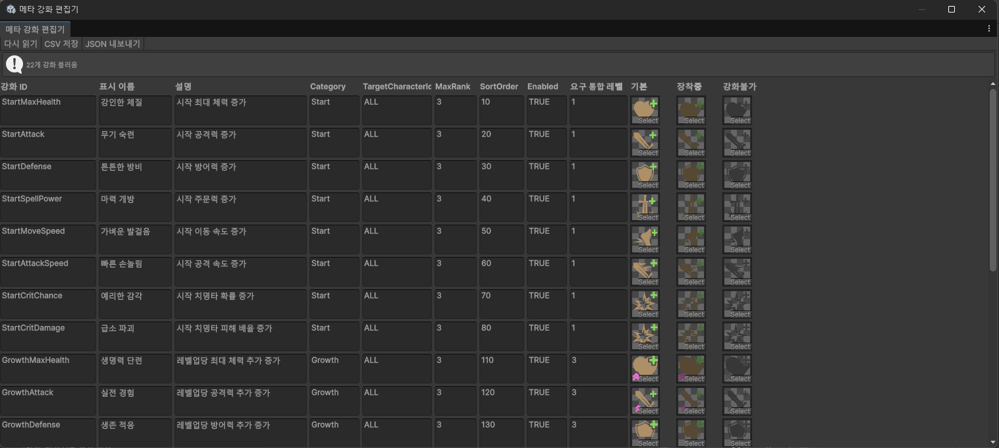 
  메타 강화 편집기

## 사용 기술

| 기술 | 사용 목적 |
| --- | --- |
| Unity 6 / C# | 게임 기능 개발 |
| Universal Render Pipeline | 3D 렌더링 |
| URP Renderer Feature | 캐릭터를 가리는 장애물 잘라내기 |
| Cinemachine | 카메라가 따라갈 대상 지정 |
| ScriptableObject | 스킬·콤보·캐릭터·퀘스트 설정 |
| NavMesh | 이동, 돌진 경로 검사, 미니맵 추출 |
| Unity UI / TextMeshPro | 게임 화면과 텍스트 표시 |
| Firebase Authentication / Firestore | 로그인과 계정 데이터 저장 |
| Newtonsoft Json / 로컬 JSON | 저장 데이터 변환과 파일 저장 |
| C# event / Task | 변경 알림과 비동기 저장 |
| Unity Editor Extension | 데이터 편집, 스킬 실험, 이펙트 미리보기, 맵 생성 |